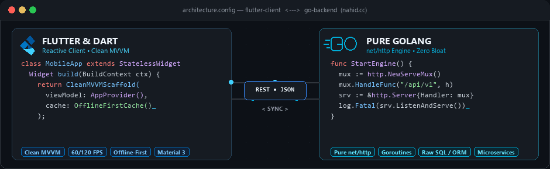

  <h1>Hi, I'm MD. Nahid Hossen</h1>

  

  

    <strong>Crafting scalable, high-performance mobile applications and minimal, robust backend systems.</strong>
  

  

    
    
    
    
  

   

  <picture>
    <source media="(prefers-color-scheme: dark)" srcset="./assets/flutter-golang-dark.gif">
    <source media="(prefers-color-scheme: light)" srcset="./assets/flutter-golang-light.gif">
    
  </picture>

 

---

### About Me & Engineering Philosophy

I am a **Full Stack Software Engineer** specializing in the intersection of **performant mobile client development** and **lightweight, concurrent backend systems**.

- **Mobile Development**: Architecting clean, reactive cross-platform mobile apps using **Flutter & Dart** with clean state management, modular MVVM architecture, smooth animations, and resilient offline-first caching.
- **Backend Architecture**: Engineering high-throughput backend services using **Pure Golang**. I prioritize the Go standard library (`net/http`) over heavy web frameworks to ensure deterministic routing, minimal memory footprint, zero dependency bloat, and long-term stability.
- **Open Source Contributor**: Creator and maintainer of developer-friendly packages on **pub.dev**, empowering Flutter developers with reusable utilities, CLI scaffolding tools, and media modules.
- **Infrastructure & Databases**: Experienced with **PostgreSQL**, **MySQL**, **Redis**, **Docker containerization**, and running resilient services on **Debian/Linux** environments.

---

### Published Open Source Packages

Here are some of the open-source tools and packages I've developed and published on [pub.dev](https://pub.dev):

| Package | Status & Version | Description |
| :--- | :--- | :--- |
| [**easiness**](https://pub.dev/packages/easiness) |   | Powerful utility suite designed to streamline everyday Flutter and Dart workflows. |
| [**fmp**](https://pub.dev/packages/fmp) |   | Flutter module and architecture companion for faster, structured application development. |
| [**multi_image**](https://pub.dev/packages/multi_image) |   | Seamless, performant multi-image picking, compression, and UI display component for Flutter. |
| [**scaffold_cli**](https://pub.dev/packages/scaffold_cli) |   | Developer CLI utility for generating boilerplate-free, clean-architecture project scaffolds. |

---

### Technical Stack & Tooling

<table width="100%">
  <tbody>
    <tr>
      <td width="22%"><strong>Mobile</strong></td>
      <td>Flutter, Dart, Material 3, MVVM Architecture, Provider, BLoC, Custom Animations, SQLite / Hive Caching</td>
    </tr>
    <tr>
      <td><strong>Backend</strong></td>
      <td>Golang (Pure <code>net/http</code>, Goroutines), Clean / Layered Architecture, RESTful APIs, JWT Auth, Custom Middleware</td>
    </tr>
    <tr>
      <td><strong>Databases & Queues</strong></td>
      <td>PostgreSQL, MySQL, Redis, Supabase, Firebase, RabbitMQ</td>
    </tr>
    <tr>
      <td><strong>DevOps & Systems</strong></td>
      <td>Docker, Kubernetes, Linux (Debian, Ubuntu), AWS Cloud Services, Git & GitHub Actions (CI/CD)</td>
    </tr>
    <tr>
      <td><strong>Developer Tools</strong></td>
      <td>VS Code, Android Studio, Postman, Terminal / Bash, Figma</td>
    </tr>
  </tbody>
</table>

  <a href="https://skillicons.dev">
    <picture>
      <source media="(prefers-color-scheme: dark)" srcset="https://skillicons.dev/icons?i=flutter,dart,go,postgres,mysql,redis,rabbitmq,docker,kubernetes,aws,linux,debian,firebase,supabase,git,github,vscode,androidstudio&theme=dark&perline=18">
      <source media="(prefers-color-scheme: light)" srcset="https://skillicons.dev/icons?i=flutter,dart,go,postgres,mysql,redis,rabbitmq,docker,kubernetes,aws,linux,debian,firebase,supabase,git,github,vscode,androidstudio&theme=light&perline=18">
      
    </picture>
  </a>

---

### GitHub Activity & Analytics

  

    <a href="https://github.com/mdnahidhossen1911">
      <picture>
        <source media="(prefers-color-scheme: dark)" srcset="https://streak-stats.demolab.com?user=mdnahidhossen1911&theme=tokyonight&hide_border=true&ring=007ACC&fire=007ACC&currStreakNum=FFFFFF">
        <source media="(prefers-color-scheme: light)" srcset="https://streak-stats.demolab.com?user=mdnahidhossen1911&theme=github-light&hide_border=true&ring=007ACC&fire=007ACC">
        
      </picture>
    </a>
    <a href="https://github.com/mdnahidhossen1911">
      <picture>
        <source media="(prefers-color-scheme: dark)" srcset="https://github-stats-extended.vercel.app/api/top-langs?username=mdnahidhossen1911&layout=compact&theme=tokyonight&hide_border=true&title_color=007ACC&langs_count=8">
        <source media="(prefers-color-scheme: light)" srcset="https://github-stats-extended.vercel.app/api/top-langs?username=mdnahidhossen1911&layout=compact&theme=default&hide_border=true&title_color=007ACC&langs_count=8">
        
      </picture>
    </a>
  

---

### Let's Connect & Collaborate

Whether you're looking to build a high-performance mobile app, design an efficient Go backend, or discuss open-source collaborations, I'd love to hear from you!

- **Portfolio Website**: [nahid.cc](https://nahid.cc)
- **LinkedIn Profile**: [linkedin.com/in/nahid-hossen](https://www.linkedin.com/in/nahid-hossen)
- **X (Twitter)**: [@NahidHossen1911](https://twitter.com/NahidHossen1911)
- **Direct Email**: [mdnahidhossen1911@gmail.com](mailto:mdnahidhossen1911@gmail.com)

  Designed & engineered with care by <strong>MD. Nahid Hossen</strong> • Open to opportunities

